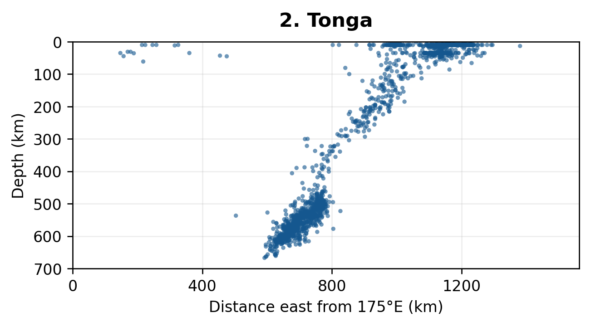

# Subduction Zone Seismicity Analysis in MATLAB

Distance–depth profiles of earthquake hypocentres across five subduction zones. The project compares how seismicity deepens across each region and where the selected catalogues provide sparse coverage. It grew out of a UCL GEOL0004 Dynamic Earth practical.



## Reproduce the profiles

Open the repository folder in MATLAB and run:

```matlab
summary = plot_cross_sections()
```

The function opens five figures and returns the plotted earthquake count and maximum depth for each region. The input CSV snapshots are bundled in [data/](data/). The example images in [figures/](figures/) come from the coursework plots. The code uses base MATLAB.

## Method

1. Read each saved USGS catalogue and retain entries classified as earthquakes. This excludes one volcanic eruption in the Tonga catalogue.
2. Use a spherical Earth with radius 6,371 km. Convert latitude differences to northward distance for Java. For eastward sections, multiply longitude offsets by the kilometres per degree at the midpoint latitude. Wrap longitude offsets at 360° to keep the Tonga profile continuous across 180°.
3. Plot distance and depth at the same scale, with depth increasing downwards and a common depth range of 0–700 km. Collapsing each search window onto one horizontal axis gives an apparent dip in the chosen section direction.

## Results

| Region | Catalogue window | Earthquakes plotted | Maximum depth (km) |
| --- | --- | ---: | ---: |
| [Southern Izu–Bonin](figures/izu-bonin.png) | 25–26°N, 135–145°E | 190 | 584.2 |
| [Tonga](figures/tonga.png) | 21–20°S, 175°E to 170°W | 1,561 | 667.3 |
| [Java](figures/java.png) | 15–5°S, 110–111°E | 94 | 650.7 |
| [South Sandwich](figures/south-sandwich.png) | 58–57°S, 35–20°W | 610 | 307.6 |
| [Central Chile](figures/central-chile.png) | 33–32°S, 75–65°W | 317 | 178.0 |

Tonga shows a clear westward deepening trend and a populated deep cluster. Java shows overall northward deepening, with shallow and deep groups separated by sparse seismicity. Central Chile deepens eastward through the depths sampled. The maximum depths describe these catalogue selections.

## Data and tomography

The CSV snapshots came from the [USGS Earthquake Catalog](https://earthquake.usgs.gov/earthquakes/search/). They retain the original event metadata. All five exports have a lowest observed magnitude of 4.5. The exact original query dates and export dates were unavailable when preparing this repository. The bundled snapshots reproduce the selection used here.

The coursework also compared the earthquake profiles with externally generated [SubMachine](https://orfeus-eu.org/submachine/index.php) tomography panels. The MATLAB workflow generates the earthquake profiles. A quantitative comparison would require the tomography section endpoints and their alignment with the earthquake profiles.
